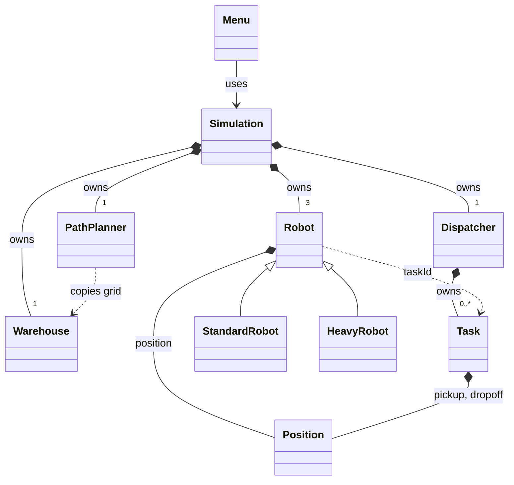

# Technical Design Document

This document explains how the Warehouse Robot Fleet Simulation is designed and why we made the choices we did. The UML class diagram in this folder (`UML.pdf`) shows the same design in diagram form.

---

## 1. Project Overview and Scope

The program simulates a small automated warehouse. Robots move around a grid, pick up items at pickup points and deliver them to drop-off points. The user controls the simulation through a console menu. They can add tasks, move the simulation forward and check on the robots and tasks.

The warehouse is a 20 x 20 grid that is built into the `Warehouse` class. It has open floor, walls, 4 pickup points and 8 drop-off points. One drop-off point at (19, 19) is boxed in by walls on purpose so we can show what happens with an unreachable destination.

The simulation starts with three robots in the top-left corner:

| Robot | Type | Starts at |
|---|---|---|
| 1 | Standard | (0, 0) |
| 2 | Standard | (0, 1) |
| 3 | Heavy | (0, 2) |

**In scope:**
- A console display of the warehouse map with the robots on it
- Three robots, each with a position, battery level and status
- Pickup and delivery tasks that go from pending to completed
- Robots that move one cell per step and never go through walls or off the map
- Battery use on every move, and a safe stop when the battery runs out
- Handling bad input, unreachable spots and unavailable robots without crashing

**Out of scope:**
- Graphics, networking, a database or real-time movement
- Traffic control between robots (see section 5)
- Automatic charging

---

## 2. Major Classes and Responsibilities

Each class has one clear job. No single class does all the work.

| Class | Responsibility | Main methods | Does NOT do |
|---|---|---|---|
| `Menu` | Shows the options, reads and checks the user's input and calls the matching `Simulation` function. Catches errors so bad input never crashes the program. | `run()`, `getChoice()`, `readInt()`, `addTask()` | Store any data or apply any rules |
| `Simulation` | Owns the warehouse, robots, dispatcher and planner. Checks new tasks and runs each step of the simulation. | `reset()`, `addTask()`, `step()`, `displayWarehouse()`, `displayRobots()`, `displayTasks()` | Read user input or find paths itself |
| `Warehouse` | Stores the grid. Knows where walls, pickups and drop-offs are. Prints the map. | `isWalkable()`, `isInBounds()`, `toPlannerGrid()`, `display()` | Move robots or know about tasks |
| `PathPlanner` | Finds the shortest route between two spots using BFS | `findPath()` | Move robots or change the map |
| `Dispatcher` | Owns all tasks. Decides which robot gets which task. | `addTask()`, `assignTasks()`, `findTask()`, `getTasks()`, `clear()` | Move robots or print anything |
| `Task` | Stores one pickup and delivery job: ID, pickup spot, drop-off spot, weight and status | getters, `setStatus()` | Choose a robot or move anything |
| `Robot` (abstract) | Stores what every robot has: ID, position, battery, status and current task ID. Moves one cell at a time and uses battery. | `moveTo()`, `assignTask()`, `clearTask()`, `canCarry()`, `batteryCostPerStep()` | Decide its own route or pick its own task |
| `StandardRobot` | A robot that carries light items and uses little battery | `canCarry()`, `batteryCostPerStep()` | |
| `HeavyRobot` | A robot that carries heavy items but uses more battery | `canCarry()`, `batteryCostPerStep()` | |
| `Position` | Stores one spot on the grid as a row and a column | `operator==`, `operator!=`, `display()` | Know what is at that spot |
| `main.cpp` | Starts the program: creates the `Simulation` and runs the `Menu` | `main()` | Contain any program logic |

---

## 3. Relationships Between Classes



**Who owns what:**
- `Simulation` owns one `Warehouse`, one `Dispatcher`, one `PathPlanner` and all the robots. When `Simulation` is destroyed, everything it owns is freed automatically.
- The robots are stored as `vector<unique_ptr<Robot>>`. We used `unique_ptr` because `Robot` is abstract, so the list has to hold `StandardRobot` and `HeavyRobot` objects through a base class pointer. `unique_ptr` deletes them for us, so we never call `delete` ourselves.
- `Dispatcher` owns every `Task`, stored by value in a `vector<Task>`.
- `Robot` and `Task` hold `Position` objects by value. A position is just two numbers, so it does not need a pointer.
- `Menu` owns nothing. It holds a reference to the `Simulation` that `main` created.

**How objects refer to each other:**
- A robot stores the **ID** of its task, not a pointer to it. When `Simulation` needs the real task it asks `Dispatcher::findTask(id)`, which returns a pointer or `nullptr`. This way only `Dispatcher` owns tasks, and two classes never try to delete the same task.
- `PathPlanner` gets its own copy of the map when `Simulation` is created, through `Warehouse::toPlannerGrid()`. The planner works on numbers (0 = open, 1 = wall) instead of the map's characters, so it does not need to know what `'P'` or `'D'` mean.

---

## 4. Inheritance and Polymorphism

```
Robot (abstract)
 ├── StandardRobot
 └── HeavyRobot
```

Every robot has an ID, a position, a battery and a status, and moves the same way. So all of that is in the base `Robot` class. The two robot types differ in two ways:

| | StandardRobot | HeavyRobot |
|---|---|---|
| Heaviest item it can carry | 10 | 50 |
| Battery used per step | 1 | 2 |

`canCarry()` and `batteryCostPerStep()` are pure virtual functions in `Robot`, so `Robot` is an abstract class. A plain robot does not exist in our program. Every robot must be one of the two types.

This is where polymorphism is used:
- The `Dispatcher` calls `canCarry()` on any robot without knowing which type it is, and the right version runs. A heavy task skips the standard robots and goes to the heavy robot.
- `Robot::moveTo()` calls `batteryCostPerStep()`, so a heavy robot automatically loses 2 battery per move while a standard robot loses 1.

If we add a new robot type later, `Dispatcher` and `Simulation` do not need to change.

These are real **is-a** relationships. A `HeavyRobot` *is a* `Robot`: it is stored in the same list, moves the same way and is assigned tasks the same way. We did not make subclasses just to show inheritance. Each one changes which tasks the robot can take and how fast it uses battery.

`Robot` has a `virtual` destructor. Robots are deleted through a `unique_ptr<Robot>`, so without it only the `Robot` part of a `HeavyRobot` would be cleaned up.

**Why `PathPlanner` is not a class hierarchy:** we only have one way of finding paths (BFS). Making an abstract base class with only one child would be adding a class just to show inheritance, so we kept `PathPlanner` as one class.

**Operator overloading:** `Position` overloads `==` and `!=`. We compare positions all the time, for example to check if a robot reached its pickup spot. `robot.getPosition() == target` is much easier to read than comparing the row and column separately every time.

---

## 5. One Simulation Step

When the user chooses "Advance Simulation", `Simulation::step()` does the following in order:

1. The `Dispatcher` gives pending tasks to robots that are free (see section 8).
2. Each robot is updated in order of its ID:
   - If it has no task, nothing happens.
   - If it is standing on its target, it picks up the item (task becomes PICKED_UP) or delivers it (task becomes COMPLETED and the robot becomes IDLE). Picking up or delivering takes that robot's whole step.
   - Otherwise it asks `PathPlanner` for a route and moves one cell along it, using battery.

The user can advance one step at a time or several steps at once (1 to 100). Each step prints its number and any pickups, deliveries or failures.

**Rule when two robots want the same cell:** robots are allowed to share a cell. The assignment says multi-robot traffic management is not required, and we can use a simple documented rule. We first planned to make a robot wait if the next cell was taken. We dropped that because an idle robot never moves, so a robot whose path goes through an idle robot would wait forever.

---

## 6. Robot Movement and Battery

Every robot starts with 100 battery. Each move uses battery: 1 for a standard robot and 2 for a heavy robot. A robot only moves to cells on the route from `PathPlanner`, and the planner never uses walls or cells off the map. So a robot never goes through a wall.

**Before a task is assigned:** the `Dispatcher` estimates the trip length (robot → pickup → drop-off) by counting rows and columns between the spots. It multiplies that by the robot's battery cost per step. The robot only gets the task if its battery covers that amount.

**If the battery runs out during a trip:** the estimate ignores walls, so a real trip can be longer than expected. If a robot does not have enough battery for its next move:
- The robot stays where it is and its status becomes OUT_OF_BATTERY. It will not get any more tasks.
- If it had not picked up the item yet, the task goes back to PENDING so another robot can take it.
- If it was carrying the item, the task is marked FAILED.

This is our safe recovery action. There is no automatic charging.

---

## 7. Pathfinding

`PathPlanner::findPath()` uses Breadth-First Search (BFS). It starts at the robot's spot and checks the cells next to it (up, down, left, right) one step away, then two steps away, and so on until it reaches the goal. It skips walls and cells off the map.

It returns a `PathResult` with two parts:
- a status (`Success`, `Unreachable`, `BlockedGoal` and a few others)
- the route as a list of positions, starting at the robot's own spot and ending at the goal

`Simulation` moves the robot to the second position in the list (`path[1]`), since the first one is where the robot already is.

We chose BFS because it is simple and always finds a shortest route on a grid. The assignment does not require the best route, but BFS gives it to us anyway. The route is found again every step. The map never changes, so the robot keeps following the same shortest route, and the code stays simple.

**Unreachable spots** are caught in two places:
1. When a task is added, `Simulation::addTask()` checks that there is a route from the pickup to the drop-off. If not, the task is rejected right away with a message.
2. During a step, if a robot cannot find a route to its target, the task is marked FAILED and the robot goes back to IDLE. This is a safety net in case the first check misses something.

---

## 8. Task Lifecycle and Assignment

```
PENDING → ASSIGNED → PICKED_UP → COMPLETED
   ↑         │           │
   └─────────┘           └──→ FAILED
 (battery ran out       (battery ran out while
  before pickup)         carrying, or no route)
```

- **PENDING:** the task was added and is waiting for a robot.
- **ASSIGNED:** a robot was given the task and is moving to the pickup.
- **PICKED_UP:** the robot has the item and is moving to the drop-off.
- **COMPLETED:** the item was delivered.
- **FAILED:** the task cannot be finished.

The `Dispatcher` goes through pending tasks in the order they were added. It gives each one to the first robot (lowest ID) that:
- is IDLE and has no task
- can carry the task's weight
- has enough battery for the estimated trip

If no robot fits, the task stays PENDING and is tried again next step. A task heavier than 50 can never be carried by any robot, so it stays PENDING. The user can see this in "Display Tasks".

---

## 9. Error Handling

The program never crashes from bad input or a failed task. We used the standard C++ exception `invalid_argument` instead of writing our own exception classes. The standard ones already describe our problems well, and the message passed with each one tells the user exactly what went wrong.

`Simulation::addTask()` checks every new task and throws `invalid_argument` with a message if something is wrong. `Menu::addTask()` calls it inside a `try` block and catches the exception. It prints the message and the menu keeps running. We split it this way so `Simulation` decides what a valid task is, and `Menu` decides how to tell the user.

Simple input problems, like letters instead of numbers, are checked right in `Menu` with `if` statements and loops. They do not need exceptions because `Menu` can just ask again.

| Problem | Where it is handled | What the user sees |
|---|---|---|
| Menu choice is not a number, has extra words or is out of range | `Menu::getChoice()` | "Invalid choice. Please enter 1-7." and they can try again |
| A row, column, weight or step count is not a number | `Menu::readInt()` | "Please enter a whole number." and they can try again |
| Pickup or drop-off is a wall or off the map | `Simulation::addTask()` throws | An error message. The task is not added. |
| Weight is 0 or less | `Simulation::addTask()` throws | An error message. The task is not added. |
| Drop-off cannot be reached from the pickup | `Simulation::addTask()` throws | An error message. The task is not added. |
| Step count is not from 1 to 100 | `Menu::run()` | "Steps must be from 1 to 100." |
| No robot can take a task right now (all busy, too heavy or low battery) | `Dispatcher::assignTasks()` | The task stays PENDING |
| Robot runs out of battery | `Simulation::updateRobot()` | A message. The task goes back to PENDING or is marked FAILED. |
| No route found during a step | `Simulation::updateRobot()` | A message. The task is marked FAILED. |
| Input ends (Ctrl+D) | `Menu` | The program exits cleanly |

---

## 10. Menu Options

| Option | What it does |
|---|---|
| 1. Display Warehouse | Prints the map with each robot's ID on its square |
| 2. Display Robots | Shows every robot's position, battery and status |
| 3. Display Tasks | Shows every task's pickup, drop-off, weight and status |
| 4. Add Task | Asks for the pickup row and column, drop-off row and column, and weight |
| 5. Advance Simulation | Asks how many steps (1 to 100) and runs them |
| 6. Reset Simulation | Removes all tasks and puts 3 fresh robots back at the start |
| 7. Exit | Ends the program |

---

## 11. Key Design Decisions

| Decision | Why |
|---|---|
| Two robot types that differ in weight limit and battery cost | Gives the inheritance a real reason. The `Dispatcher` and battery use change based on the robot type. |
| Objects refer to each other by ID, not pointer | Only one class owns each object, so nothing is deleted twice. Same idea as our Campus Event System project. |
| `unique_ptr` for robots | Needed to store different robot types in one list. Frees memory automatically. |
| One `PathPlanner` class with BFS | Simple, always finds a shortest route, and we only need one way of finding paths. |
| Map built into `Warehouse` instead of loaded from a file | The assignment only needs one small fixed warehouse. This also removes file errors from the program. |
| Robots may share a cell | Allowed by the assignment. A waiting rule could leave robots stuck forever behind idle robots. |
| Standard exceptions instead of custom ones | `invalid_argument` already fits our problems, and the message explains each case. |
| Battery check estimates the trip without walls | Simple to compute. If the real trip is longer, the out-of-battery recovery handles it safely. |

---

## 12. Testing

Each group wrote tests for its own classes. Each test file has its own `main()`, so each one is built and run as its own small program. The README shows how.

| Test file | What it checks |
|---|---|
| `tests/RobotTests.cpp` | Starting values, weight limits for both robot types (exactly at the limit, one over, zero and negative), battery used per step, robots stopping safely when the battery runs out, task and status functions, and polymorphism through `unique_ptr<Robot>` |
| `tests/PathPlannerTests.cpp` | 20 cases: shortest routes, routes around walls, unreachable goals, spots off the map, blocked start or goal, already at the goal, avoiding other robots' spots, bad grids, a larger grid, and both the number grid and the character grid |
| `tests/DispatcherTests.cpp` | 26 checks: adding and finding tasks, heavy tasks skipping standard robots, too-heavy tasks staying pending, one task per robot, tasks given out in order, low-battery robots being skipped (standard and heavy), out-of-battery robots being skipped, finished tasks not being reassigned, and `clear()` |

**Edge cases tested by hand through the menu:**
- Typing letters, extra words or out-of-range numbers at every prompt
- A pickup or drop-off on a wall or off the map
- A weight of 0 or a negative weight
- A task to the walled-in drop-off at (19, 19)
- A task heavier than 50 that no robot can carry
- More tasks than free robots
- Reset in the middle of a run

---

## 13. Known Limitations

- Robots can share a cell (see section 5).
- The battery check before assigning a task ignores walls, so a robot can still run out of battery on a long trip around walls. When that happens the robot stops safely and the task is put back or marked failed.
- A robot that runs out of battery stays out of battery until the simulation is reset. There is no charging.
- The map is fixed. To change it, the layout in `Warehouse::loadDefault()` has to be edited.
- A task heavier than 50 stays pending forever because no robot can carry it.